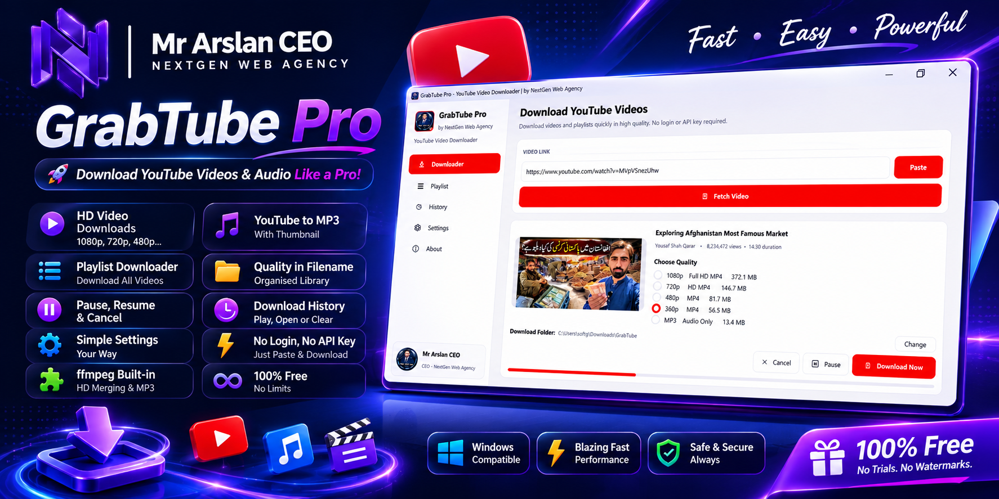
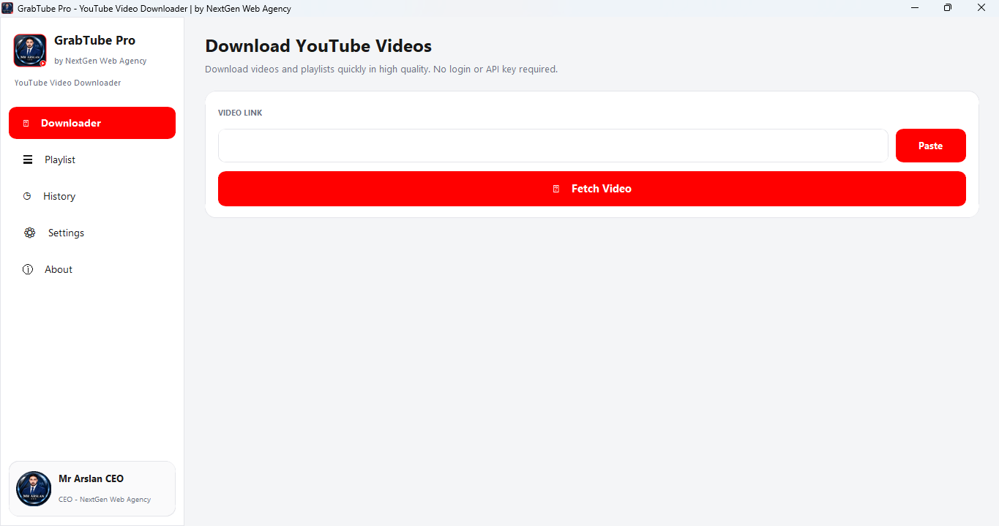
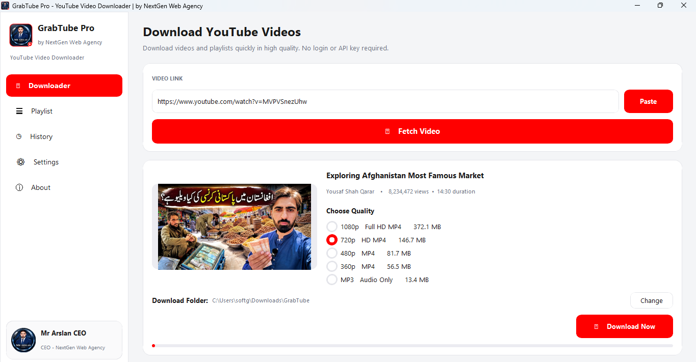
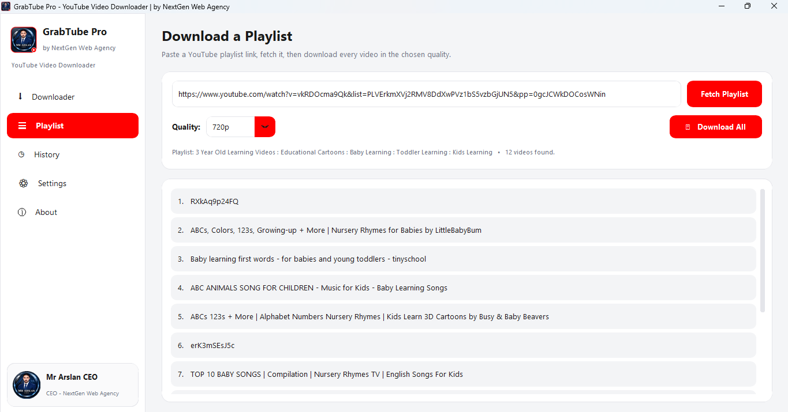
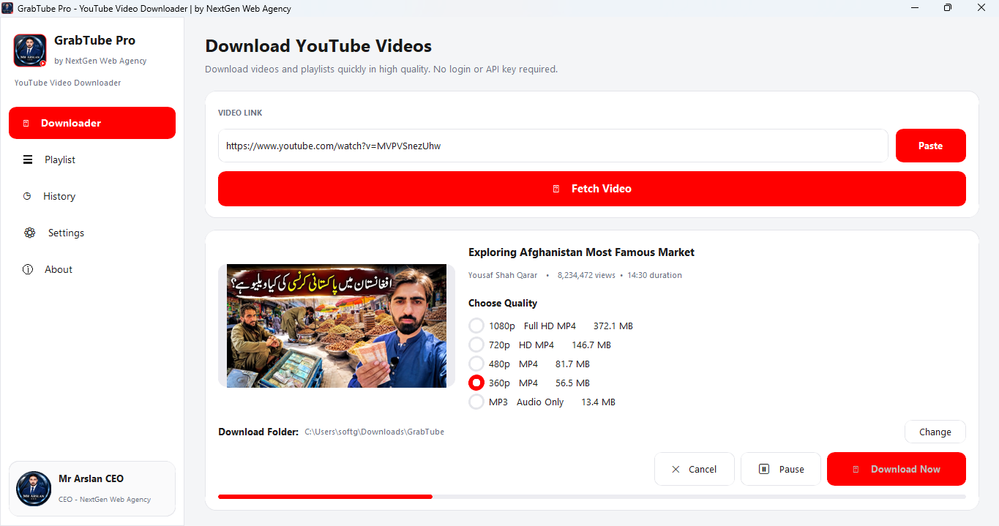
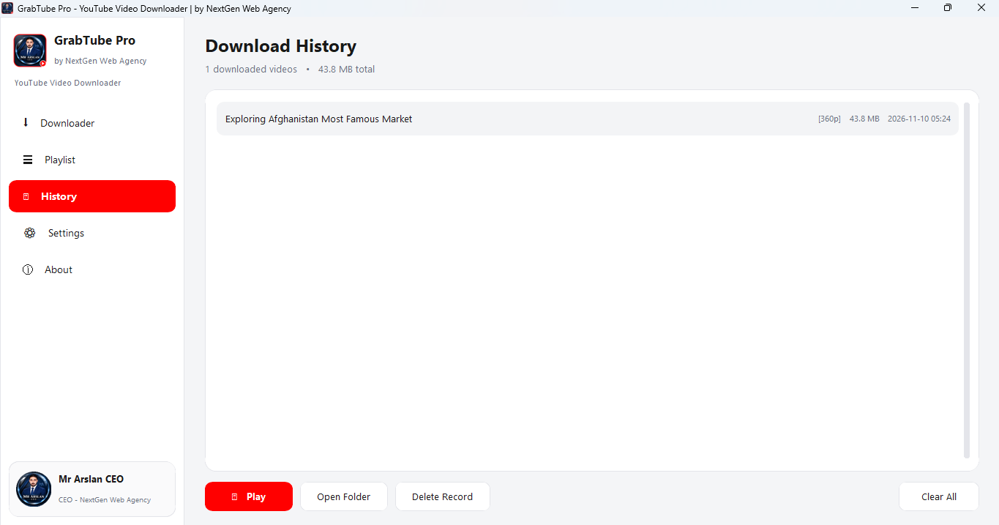
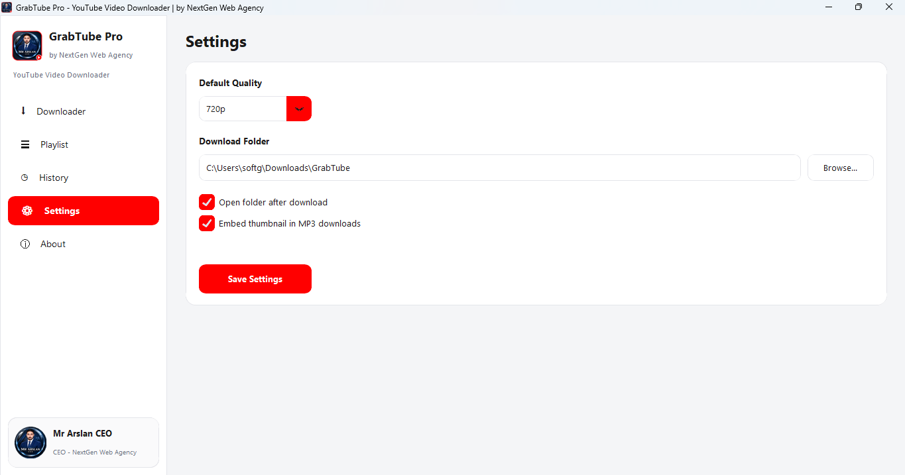
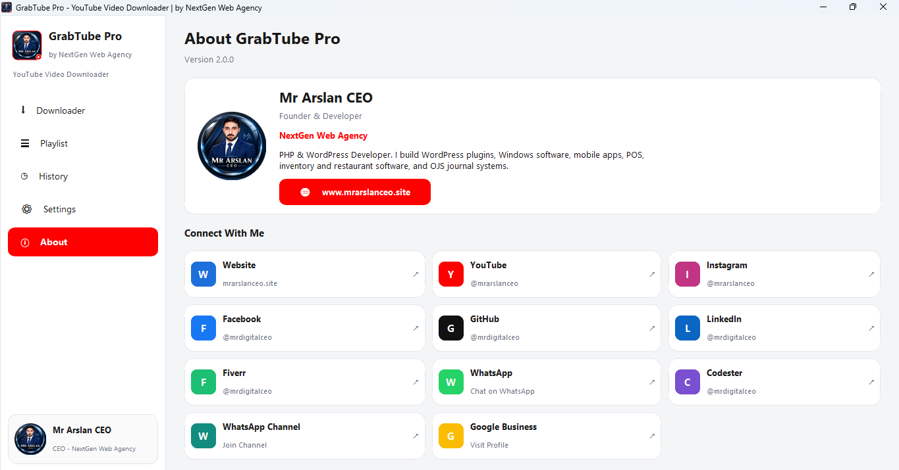

  

  

<h1 align="center">GrabTube Pro — Free YouTube Video Downloader for Windows</h1>

  <strong>Download YouTube videos in HD, convert YouTube to MP3, and download full playlists — fast, free, and with no login or API key.</strong>

  
  
  
  

  
  
  

> ⭐ **If GrabTube Pro saves you time, please star this repository** — it is free, takes one second, and motivates new features and updates.

---

## 📥 Download

**[⬇️ Download GrabTube Pro v2.0.0 for Windows (Free)](https://github.com/mrdigitalceo/grabtube-pro/releases/latest)**

Download `GrabTubePro-Setup-v2.exe` from the latest release, run it, and follow the setup wizard. No Python, no extra tools, nothing else to install — everything the app needs is built in.

## ✨ Features

- 🎬 **HD video downloads** — 1080p Full HD, 720p, 480p, 360p and lower, with the exact file size shown before you download
- 🎵 **YouTube to MP3 converter** — extract audio only, with the video thumbnail embedded in the MP3
- 📂 **Playlist downloader** — paste a playlist link and download every video in your chosen quality
- 🏷️ **Quality label in every filename** — files save as `Video Title [720p].mp4` or `Video Title [MP3].mp3`, so your library stays organised
- ⏸️ **Pause, resume and cancel** downloads with a clean live progress bar
- 🕘 **Download history** — every download recorded with quality, size and date; play, open folder, or clear records anytime
- ⚙️ **Simple settings** — default quality, custom download folder, open-folder-after-download option
- 🔑 **No login and no API key** — paste a link and download; it just works
- 🧩 **ffmpeg built in** — HD merging and MP3 conversion work out of the box, nothing to configure
- 🆓 **100% free** — no trials, no watermarks, no download limits

## 🖼️ Screenshots

**Downloader — paste a link, fetch, download**

**Choose your quality — sizes shown upfront**

**Download full playlists in one go**

**Live progress with pause and cancel**

**History with quality labels**

**Clean, simple settings**

**About the developer**

## 🚀 How to Install

1. Download `GrabTubePro-Setup-v2.exe` from the **[latest release](https://github.com/mrdigitalceo/grabtube-pro/releases/latest)**.
2. Double-click the file and follow the setup wizard (Next → Install → Finish).
3. Open **GrabTube Pro** from your Desktop or Start Menu — done!

> **Windows SmartScreen note:** GrabTube Pro is free software from an independent developer and is not code-signed yet, so Windows may show *"Windows protected your PC"*. This is normal for new free software. Click **More info → Run anyway** to continue. The SHA-256 checksum printed on the release page lets you verify your download is the original file.

## 🎯 How to Use

1. Copy any YouTube video (or playlist) link.
2. Paste it in GrabTube Pro and press **Fetch Video**.
3. Pick a quality (or MP3) and press **Download Now**.
4. Find your file in the download folder — renamed neatly with its quality label.

## 💻 System Requirements

- Windows 10 or Windows 11 (64-bit)
- Internet connection
- About 500 MB of free disk space

## ❓ FAQ

**Is GrabTube Pro really free?**
Yes — completely free, with no trial period and no feature locks.

**Do I need Python or any other software installed?**
No. GrabTube Pro is a normal Windows app with a proper installer. Everything it needs, including ffmpeg, is packed inside.

**Why does Windows warn me when I run the setup?**
Because the app is published by an independent developer without a paid code-signing certificate, Windows SmartScreen shows a caution for new downloads. Choose **More info → Run anyway**. This warning fades as more people download and use the app.

**Where are my videos saved?**
By default in `Downloads\GrabTube` — you can change the folder anytime in Settings.

**Can it download private or age-restricted videos?**
No. GrabTube Pro works with publicly available videos only.

## ⚖️ Disclaimer

GrabTube Pro is a personal-use tool. Please download only content you own, content that is in the public domain, or Creative Commons / royalty-free content, and always respect YouTube's Terms of Service and the rights of content creators. This project is not affiliated with YouTube or Google.

## 👨‍💻 Developer

**Mr Arslan CEO** — Founder & Developer, **NextGen Web Agency**
PHP & WordPress Developer. I build WordPress plugins, Windows software, mobile apps, POS, inventory and restaurant software, and OJS journal systems.

| Platform | Link |
| --- | --- |
| 🌐 Website | https://www.mrarslanceo.site |
| ▶️ YouTube | https://youtube.com/@mrarslanceo |
| 📸 Instagram | https://instagram.com/mrarslanceo |
| 📘 Facebook | https://facebook.com/mrdigitalceo |
| 🐙 GitHub | https://github.com/mrdigitalceo |
| 💼 LinkedIn | https://www.linkedin.com/in/mrdigitalceo |
| 🛒 Fiverr | https://www.fiverr.com/mrdigitalceo |
| 💬 WhatsApp | https://wa.me/923164309537 |
| 🧩 Codester | https://www.codester.com/mrdigitalceo |
| 📢 WhatsApp Channel | https://whatsapp.com/channel/0029VbAW7CTGk1G2NnL85X2l |
| 📍 Google Business | https://share.google/PIRvsmmja1eTvrKxp |

## 📄 License

GrabTube Pro is **freeware** — free to download and use for personal purposes. The application is distributed as a compiled Windows installer; its source code is not included in this repository.

---

  Made with ❤️ by <a href="https://www.mrarslanceo.site">NextGen Web Agency</a> — ⭐ <a href="https://github.com/mrdigitalceo/grabtube-pro">Star this repo</a> if it helped you!

<!-- Keywords: free youtube video downloader for pc, youtube downloader windows 11, youtube downloader windows 10, download youtube videos hd, youtube to mp3 converter free, youtube playlist downloader, save youtube videos offline, grabtube pro, nextgen web agency -->
